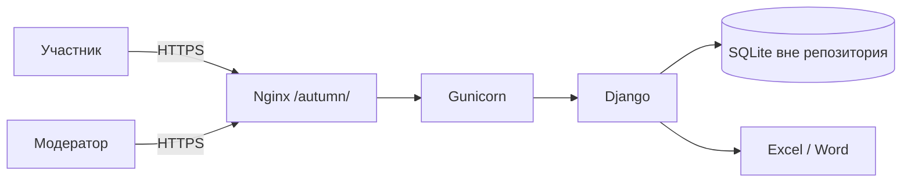

<div align="center">


# Краски осени

**Система регистрации на корпоративный семейный праздник**

[](https://www.djangoproject.com/)
[](https://www.python.org/)
[](https://github.com/Saborrr/autumn-festival-registration/actions/workflows/ci.yml)


Адаптивная форма, командные лимиты, модерация и безопасные Office-выгрузки — в одном небольшом Django-приложении.

</div>


## О проекте

Сайт заменяет разрозненные формы и таблицы при регистрации сотрудников и их семей на мероприятие. Участник выбирает формат участия и команду, а организаторы видят актуальную загрузку, управляют регистрациями и выгружают результаты в Excel или Word.

Рабочая публикация: **[gofaraway.mooo.com/autumn](https://gofaraway.mooo.com/autumn/)**

> Репозиторий приватный. Реальная база регистраций, секреты и учётные данные в Git не добавляются.

## Возможности

### Для участников

- три категории: «Большая игра», болельщик и конкурс «Счастье в пирогах»;
- выбор игровой команды с отображением свободных мест и состава;
- регистрация взрослого родственника и/или детей;
- уточнение количества и возраста детей;
- адаптивная форма для телефона и компьютера;
- защита от записи в уже заполненную команду;
- понятная серверная валидация противоречивых вариантов.

### Для организаторов

- отдельная панель модератора `/moderator/`;
- статистика, фильтрация и сортировка регистраций;
- отмена и восстановление заявок без удаления данных;
- административная панель Django `/admin/`;
- выгрузка регистраций в `.xlsx` и `.docx`;
- корректная обработка формул и управляющих символов при экспорте;
- разграничение прав модератора и суперпользователя.

## Как это устроено



- **Django 6** — формы, бизнес-правила, роли и административные интерфейсы;
- **SQLite** — production-база хранится отдельно от кода;
- **Gunicorn + systemd** — запуск приложения;
- **Nginx** — TLS и публикация приложения по URL-префиксу `/autumn/`;
- **vanilla JavaScript** — динамические поля формы без тяжёлого frontend-фреймворка;
- **openpyxl / python-docx** — Office-выгрузки.

## Быстрый старт

Требуется **Python 3.12 или новее**.

```bash
git clone https://github.com/Saborrr/autumn-festival-registration.git
cd autumn-festival-registration

python3 -m venv .venv
.venv/bin/pip install -r requirements.txt
.venv/bin/python manage.py migrate
.venv/bin/python manage.py createsuperuser
.venv/bin/python manage.py runserver
```

Откройте `http://127.0.0.1:8000/`.

## Настройка окружения

Скопируйте пример и замените демонстрационные значения:

```bash
cp .env.example .env
```

| Переменная | Назначение |
|---|---|
| `DJANGO_SECRET_KEY` | секретный ключ Django |
| `DJANGO_DEBUG` | режим отладки, в production — `0` |
| `DJANGO_ALLOWED_HOSTS` | разрешённые хосты через запятую |
| `DJANGO_CSRF_TRUSTED_ORIGINS` | доверенные HTTPS-origin |
| `DJANGO_FORCE_SCRIPT_NAME` | URL-префикс, например `/autumn` |
| `DJANGO_DB_PATH` | путь к SQLite вне каталога приложения |
| `DJANGO_STATIC_ROOT` | каталог собранной статики |

Файл `.env`, локальная база `db.sqlite3`, виртуальное окружение и собранная статика исключены через `.gitignore`.

## Роли

1. Создайте администратора командой `createsuperuser`.
2. Через `/admin/auth/user/add/` создайте пользователя-модератора.
3. Включите ему `is_staff`, не выдавая статус суперпользователя.
4. Модератор входит через `/login/` и работает в `/moderator/`.

## Проверки

```bash
.venv/bin/python manage.py test
.venv/bin/python manage.py check

DJANGO_DEBUG=0 \
DJANGO_SECRET_KEY='ci-only-secret-key-with-more-than-fifty-characters-123456789' \
DJANGO_ALLOWED_HOSTS='example.org' \
.venv/bin/python manage.py check --deploy
```

В проекте проверяются модели, формы, публичные сценарии, лимиты команд, права модератора, отмена и восстановление, фильтры, комбинированное сопровождение и Office-выгрузки. Те же проверки автоматически запускает GitHub Actions.

## Развёртывание

Примеры находятся в [`deploy/`](deploy/):

- [`autumn-festival.service`](deploy/autumn-festival.service) — unit для systemd;
- [`nginx-location.conf`](deploy/nginx-location.conf) — публикация под `/autumn/`.

Основные команды:

```bash
.venv/bin/python manage.py migrate
.venv/bin/python manage.py collectstatic --noinput
.venv/bin/gunicorn config.wsgi:application \
  --bind 127.0.0.1:8010 \
  --workers 2 \
  --timeout 30
```

Production-секреты задаются на сервере через файл окружения и не должны попадать в GitHub Actions или историю Git.

## Структура

```text
config/                 настройки и маршрутизация Django
registrations/          бизнес-логика приложения
├── migrations/         миграции и начальное заполнение команд
├── static/             CSS, JavaScript и изображения
├── templates/          публичные и служебные страницы
└── tests/              автоматические тесты
deploy/                 примеры systemd и Nginx
```

## Безопасность и данные

- не коммитьте базы регистраций, дампы и экспортированные документы;
- не размещайте реальные пароли и `DJANGO_SECRET_KEY` в issues или коде;
- перед миграциями production-базы создавайте резервную копию;
- найденные уязвимости сообщайте приватно — подробнее в [`SECURITY.md`](SECURITY.md).

## Лицензия

Внутренний частный проект. Использование, копирование и распространение — только с разрешения владельца репозитория.

## Благодарности

Фоновое фото: SimonP, *Confederation Park autumn*, Wikimedia Commons.
